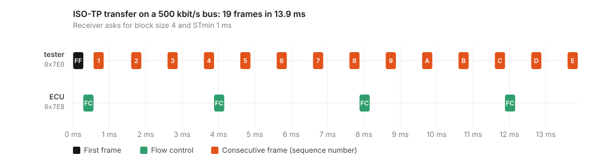

# isotp-lite

**ISO 15765-2 (ISO-TP) transport layer for classic CAN, with a bus simulator to prove it.**

ISO-TP is the protocol under UDS diagnostics and ECU flashing. It splits messages of up to 4095 bytes into 8-byte CAN frames, with flow control between sender and receiver. This implementation is about 300 lines of C99. It has no heap, no globals and no OS dependency. On a Cortex-M4 it compiles to **1.2 KB of code and 84 bytes of RAM per link** (`-Os`, measured in CI).

[](https://github.com/dusancorlija/isotp-lite/actions/workflows/ci.yml)



## Features

- Single / first / consecutive / flow-control frames, messages of 1 to 4095 bytes
- Block size and STmin, in both the millisecond and the 100 µs ranges; reserved values handled per the standard
- STmin honoured across block boundaries, not just inside a block
- FC.WAIT with a configurable limit, FC.OVFLW, N_Bs and N_Cr timeouts
- Sequence-number checking with wrap-around, optional frame padding
- Full duplex: one link sends and receives at the same time
- A full TX mailbox is not an error: the frame is retried on the next poll
- Wrap-safe 32-bit microsecond clock (it wraps every 71.6 minutes)

## The simulator

`sim/vbus.c` is a discrete-time model of a classic CAN bus. It is what makes the timing behaviour testable on a laptop:

- per-node TX mailboxes of limited depth,
- bitwise arbitration (the lowest ID wins when the bus goes idle),
- frame duration from the bit rate, with worst-case bit stuffing,
- a fault-injection hook that can drop any frame on the wire,
- a candump-compatible trace (`tools/timeline.py` turns it into the chart above).

## What block size and STmin cost

4095-byte message at 500 kbit/s (`examples/throughput.c`):

| Receiver BS | Receiver STmin | Transfer time | Goodput | Bus load |
|---:|---:|---:|---:|---:|
| 0 | 0 | 164.4 ms | 199.3 kbit/s | 98.6 % |
| 0 | 0.5 ms | 292.9 ms | 111.9 kbit/s | 55.3 % |
| 0 | 1 ms | 584.9 ms | 56.0 kbit/s | 27.7 % |
| 0 | 5 ms | 2920.9 ms | 11.2 kbit/s | 5.5 % |
| 8 | 0 | 184.8 ms | 177.3 kbit/s | 98.6 % |
| 8 | 1 ms | 584.9 ms | 56.0 kbit/s | 31.1 % |
| 1 | 0 | 327.9 ms | 99.9 kbit/s | 98.6 % |
| 1 | 5 ms | 2920.9 ms | 11.2 kbit/s | 11.1 % |

How to read it:

- With STmin = 0 and no block limit, a single transfer saturates the bus. Every other ECU's periodic traffic now competes with the download.
- STmin is the knob that trades speed for bus capacity. Block size mainly protects a slow receiver's buffer; once STmin dominates, BS costs almost nothing.
- BS = 1 halves throughput, because every consecutive frame waits for a flow-control round trip.
- Padding to 8 bytes only lengthens the final frame (0.2 ms per message here).

## Firmware download over UDS

`examples/uds_download.c` puts a small UDS server (ISO 14229) on the simulated ECU and drives it from a tester:

```
  -> service 0x22, 3 bytes
(   0.000285) vcan0 7E0#0322F190CCCCCCCC
(   0.000570) vcan0 7E8#101062F190565349
(   0.000850) vcan0 7E0#300000CCCCCCCCCC
(   0.001130) vcan0 7E8#214D303030303030
(   0.001410) vcan0 7E8#22303030CCCCCCCC
  <- 62 F1 90 56 53 49 4D 30   VIN prefix "VSIM000000000"
  -> service 0x34, 11 bytes
  ...
  <- 7F 34 7F   negative response, NRC 0x7F    (download refused in default session)
  -> service 0x10, 2 bytes                       (switch to programming session)
  ...
Downloaded 16384 bytes in 0.701 s (187.0 kbit/s goodput), 2518 CAN frames.
CRC-32 tester 0xAF1F4A91, ECU 0xAF1F4A91: match
```

The ECU checks the session, the block sequence counter (with 0xFF → 0x00 wrap) and the image length, and returns the matching negative response codes.

## Usage

```c
#include "isotp.h"

static uint8_t rx_buf[ISOTP_MAX_LEN];
static isotp_link_t diag;

static int can_tx(void *user, uint32_t id, const uint8_t *data, uint8_t len)
{
    return hal_can_send(id, data, len) == HAL_OK ? 0 : -1; /* -1 = mailbox full, retried later */
}

void diag_init(void)
{
    isotp_config_t cfg = {
        .tx_id = 0x7E8, .rx_id = 0x7E0,
        .send = can_tx,
        .rx_buf = rx_buf, .rx_cap = sizeof(rx_buf),
        .block_size = 8, .st_min = 0x00, .padding = 0xCC,
    };
    isotp_init(&diag, &cfg);
}

void can_rx_isr(uint32_t id, const uint8_t *data, uint8_t len)
{
    if (id == 0x7E0)
        isotp_on_frame(&diag, data, len, micros());
}

void every_1ms(void)
{
    isotp_poll(&diag, micros());
    const int n = isotp_rx_take(&diag);
    if (n > 0)
        uds_handle(rx_buf, (uint16_t)n);
}
```

If `isotp_on_frame` runs in an interrupt and `isotp_poll` in a task, guard them with the same lock or feed received frames through a queue. A link is not reentrant.

## Tests

`tests/test_isotp.c` covers, among others:

- every single-frame length and multi-frame boundary sizes (8, 13, 14, 15, 111–113, 4094, 4095)
- a block-size × STmin matrix, and measured on-wire gaps ≥ STmin, also across block boundaries
- receiver overflow → FC.OVFLW → sender aborts
- a lost flow control (N_Bs timeout), a lost consecutive frame (sequence error), a lost last frame (N_Cr timeout)
- FC.WAIT handling and the WAIT limit, a full TX mailbox, invalid and stray frames, clock wrap-around
- simultaneous transfers in both directions
- 200 000 random frames under ASan + UBSan

CI builds with GCC and Clang (`-Wall -Wextra -Wpedantic -Wconversion -Werror`) under sanitizers. It also cross-compiles for Cortex-M0+, M4 and M7:

| Target | Code (`-Os`) | RAM per link |
|---|---:|---:|
| Cortex-M0+ | 1260 B | 84 B |
| Cortex-M4 | 1204 B | 84 B |
| Cortex-M7 | 1204 B | 84 B |

## Build

```bash
cmake -S . -B build && cmake --build build
ctest --test-dir build --output-on-failure
./build/throughput
./build/uds_download
./build/trace 100 4 0x01 > trace.log && python3 tools/timeline.py trace.log timeline.svg
```

## Scope

Supported: normal addressing, classic CAN, 12-bit message length. Not supported: extended / mixed addressing, CAN FD frames longer than 8 bytes, and the 32-bit first-frame length escape (answered with FC.OVFLW). Each of these is a contained change in `src/isotp.c`.

## License

MIT
